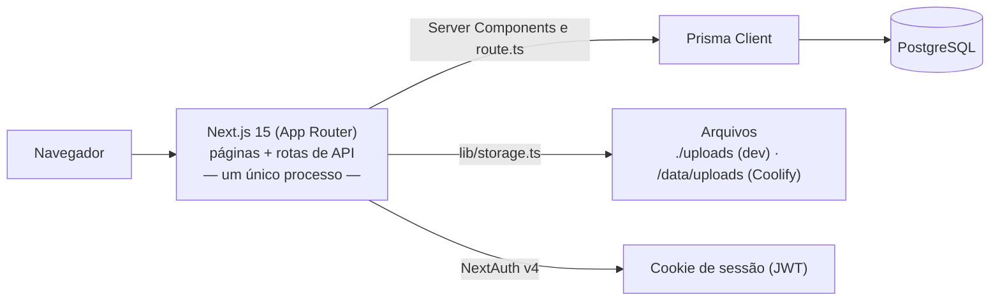

# 01 — Arquitetura

> Como o Movimento em Jogo é montado: um repositório, um processo Next.js, um banco PostgreSQL.

## Visão geral



- **Não existe backend separado.** As rotas de API (`src/app/api/**/route.ts`) rodam no mesmo processo e deploy das páginas.
- **Leitura de dados** é feita direto no servidor: as páginas são *Server Components* e chamam `prisma` ou `src/lib/` sem passar por API.
- **Rotas de API** existem só para o que o navegador precisa enviar: formulários, aprovar/rejeitar, excluir, foto de perfil.

## Camadas e responsabilidades

| Camada | Onde | Regra |
|---|---|---|
| Páginas | `src/app/**/page.tsx` | Server Component por padrão. Exigem login com `requireSession()` / `requireAdminSession()` (`lib/auth.ts`). |
| Interação no navegador | arquivos com `"use client"` | Só onde há estado/clique. Enviam dados com o hook `useApiMutation`. |
| API | `src/app/api/**/route.ts` | `requireAuth()`/`requireAdmin()` → validação zod (`lib/schemas.ts`) → Prisma → `apiSuccess`/`apiError`, sempre dentro de `withApiHandler`. |
| Regras e serviços | `src/lib/` | Toda lógica reaproveitável. **Uma fonte única por assunto** (ver tabela no `README.md`). |
| Componentes visuais | `src/components/` | Reutilizados por mais de uma página. Componentes de uma página só ficam na pasta dela (ex.: `app/admin/EngagementCard.tsx`). |

## O coração: `buildSnapshot()` (`src/lib/challenge.ts`)

Busca de uma vez o desafio ativo, todos os usuários com suas atividades aprovadas no período e as metas dos setores, e devolve:

- `players` — estatísticas de cada pessoa, **já ordenadas pelo ranking oficial**;
- totais coletivos (`totalCollectiveActiveDays`, `totalCollectivePoints`, `collectiveMedal`, `collectiveNext`);
- `individualGoal` — metas de escudo por pessoa (meta coletiva ÷ participantes);
- `sectorGoals` — metas dos setores com escudo atual e próximo;
- `daysLeft` / `daysTotal`.

É usado pelo HUB (`/`), por `/meta-dos-setores` e pelo painel `/admin`. Nenhuma tela recalcula pontuação por conta própria.

## Exemplo de fluxo: registrar um exercício

```
/registrar (page.tsx, servidor)      lê a data de início do desafio para o campo de data
  └─ ActivityForm.tsx (navegador)    envia FormData via useApiMutation
       └─ POST /api/activities       requireAuth → createActivitySchema → isAllowedImage/saveUpload
                                     → prisma.activity.create (status APPROVED)
                                     → computeActiveDaysStats antes/depois = pontos ganhos
       ← { dayPointsGained, bonusGained, dayMinutes }
  └─ aviso na tela; a animação de pontos aparece no HUB (ScoreAnimation)
```

## Páginas

| Rota | Acesso | Função |
|---|---|---|
| `/login` | público | Entrada |
| `/` | logado | HUB: meta coletiva, pódio, classificação completa |
| `/registrar` | logado | Registrar exercício (aprovado automaticamente) |
| `/minhas` | logado | Histórico de exercícios, exclusão individual/em lote |
| `/demandas` · `/demandas/nova` | logado | Histórico e registro de demandas (aguardam aprovação) |
| `/meta-dos-setores` | logado | Metas por área |
| `/admin` | ADMIN | Histórico geral, demandas pendentes, engajamento semanal |
| `/admin/usuarios` | ADMIN | Cadastrar, editar e remover agentes |

## API

| Método e rota | Acesso | Função |
|---|---|---|
| `POST /api/activities` | logado | Registra exercício |
| `DELETE /api/activities/[id]` | dono ou ADMIN | Exclui exercício |
| `POST /api/demands` | logado | Registra demanda (PENDING) |
| `POST /api/demands/[id]/review` | ADMIN | Aprova (pode ajustar o peso) ou rejeita |
| `POST /api/users` · `PATCH`/`DELETE /api/users/[id]` | ADMIN | Gestão de agentes |
| `POST`/`DELETE /api/profile` | logado | Troca/remove a própria foto |
| `GET /uploads/[...path]` | logado | Serve imagens enviadas |
| `/api/auth/*` | — | NextAuth |

Respostas: sucesso `{ ok: true, ... }`; erro `{ error: "<código>" }` com status HTTP do código (`lib/api-response.ts`). O navegador mostra a mensagem correspondente de `lib/error-messages.ts`.

## Autenticação

- **NextAuth v4**, login por e-mail/senha (bcrypt), sessão JWT em cookie. Configuração em `src/lib/auth.ts`; campos extras da sessão (`id`, `role`, `avatarUrl`) tipados em `src/types/next-auth.d.ts`.
- **`src/middleware.ts`** bloqueia sem sessão todas as rotas exceto `/login`, `/api/auth`, `/uploads` e arquivos estáticos.
- **Papel ADMIN** é verificado em cada página (`requireAdminSession`) e rota (`requireAdmin`) administrativa.

## Visual

Tema "tático/Valorant" em `tailwind.config.ts` (cores `val-*`, `rpg-*`) e `src/app/globals.css` (classes `val-card`, `val-btn*`, `val-input`, `val-label`, `val-heading`, recortes `clip-notch*`, `text-gradient`, animações). Fontes: Tomorrow (títulos), Rajdhani (texto), JetBrains Mono. Cores dos escudos sempre via `lib/tiers.ts`.
