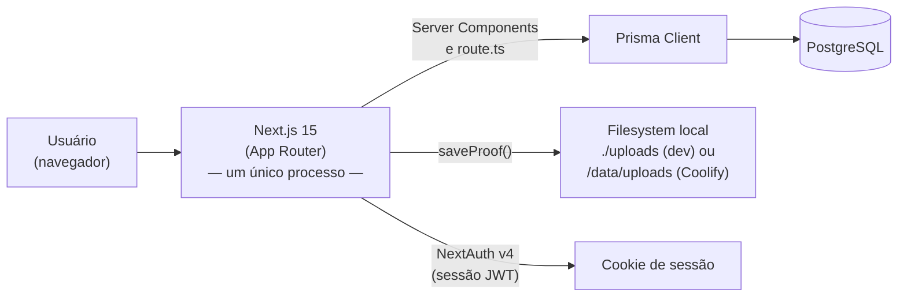

# 02 — Arquitetura

> Como o Movimento em Jogo é montado por dentro: um processo, um repositório, um banco.

---

## 2.1 — Visão de helicóptero

Ao contrário de um setup com backend e frontend em projetos separados, aqui **tudo é um único processo Next.js**:



Não existe uma "API separada" que o frontend chama por HTTP através da internet — as rotas de API (`src/app/api/**/route.ts`) rodam **no mesmo processo e no mesmo deploy** que as páginas. Quando um componente cliente faz `fetch("/api/activities")`, essa chamada é HTTP internamente (é assim que o browser funciona), mas o servidor do outro lado é o mesmo Next.js, não um serviço à parte.

Muitas páginas nem chegam a usar `fetch` para ler dado: por serem **Server Components**, elas chamam `prisma` ou funções de `src/lib/` diretamente, sem passar por uma rota de API. Uma rota de API só existe quando algo precisa ser chamado do **client** (formulário enviando `FormData`, botão de aprovar/rejeitar, etc.).

---

## 2.2 — Anatomia de uma request: registrar uma atividade física

Passo a passo real, do clique ao banco e de volta, com o arquivo exato de cada etapa:

```
1.  Usuário preenche o formulário em /registrar e clica "Salvar"
    → src/app/registrar/page.tsx

2.  O formulário monta um FormData (date, type, durationMin, notes, proof)
    e chama fetch("/api/activities", { method: "POST", body: formData })

3.  A request chega em src/app/api/activities/route.ts, função POST()

4.  auth() (NextAuth v4) resolve a sessão a partir do cookie JWT
    → src/lib/auth.ts
    Sem sessão → 401 imediato, nada mais roda.

5.  Validação manual: dateStr, type (contra um Set de valores válidos),
    durationMin > 0. Sem sessão válida OU campo inválido → 400.

6.  Se veio arquivo de comprovante, saveProof() grava no filesystem
    e devolve a URL pública /uploads/...
    → src/lib/storage.ts

7.  prisma.activity.create() grava a atividade (status inicial: APPROVED)
    → src/lib/prisma.ts (singleton do PrismaClient)

8.  getActiveChallenge() busca o desafio ativo (ou cria um, se não existir)
    → src/lib/challenge.ts

9.  computeActiveDaysStats() roda ANTES e DEPOIS da nova atividade entrar,
    pra calcular quantos pontos de dia e de bônus de constância essa
    atividade específica gerou
    → src/lib/scoring.ts

10. A rota devolve NextResponse.json({ ok: true, id, dayPointsGained, bonusGained })

11. O client recebe a resposta, toca som/animação de pontos ganhos
    (se houver) e atualiza a UI local ou faz router.refresh()

12. Na próxima visita ao HUB (/), page.tsx (Server Component) roda
    buildSnapshot() de novo, que já inclui a atividade nova no ranking
```

Note o que **não** existe nesse fluxo, ao contrário de um backend NestJS clássico: não há Controller decidindo pra qual Service delegar, não há Guard/Pipe interceptando antes do handler, não há DTO com decorators de validação, não há Repository entre o Service e o Prisma. A validação, a checagem de sessão e a chamada ao Prisma vivem juntas na função `POST` do `route.ts` (ou são extraídas para `src/lib/*.ts` quando a lógica é reutilizável — como `saveProof`, `computeActiveDaysStats`, `getActiveChallenge`).

---

## 2.3 — Repositório: um só

O projeto vive em **um único repositório**, não em `{projeto}-api` + `{projeto}-web`. Frontend e "backend" (rotas de API) compartilham:
- O mesmo `package.json` e `node_modules`.
- O mesmo deploy (um único `Dockerfile`, ver `10-devops.md`).
- Os mesmos tipos TypeScript — um `type PlayerStats` definido em `src/lib/scoring.ts` é importado tanto por uma rota de API quanto por um Server Component, sem precisar duplicar a definição nem sincronizar contratos entre repos.

---

## 2.4 — Ambientes

| Ambiente | URL | Banco | Como sobe |
|---|---|---|---|
| **Local (dev)** | `http://gamificacaogarcezconsultoria.local:3000` | PostgreSQL nativo local (`movimento_em_jogo`) | `npm run dev` (ou `iniciar-servidor.bat`) |
| **Produção** | domínio configurado no Coolify | PostgreSQL gerenciado pelo Coolify (ou apontado via `DATABASE_URL`) | Build da imagem via `Dockerfile`, deploy pelo Coolify |

Não existe ambiente de "staging" formal hoje, nem `docker-compose` de desenvolvimento — o runbook completo de setup local está em `CLAUDE.md` (seção "Runbook — rodar o projeto do zero (Windows)") e é reaproveitado, não duplicado, em [`01-onboarding.md`](./01-onboarding.md).

---

## 2.5 — Estrutura de pastas, visão geral

```
src/
├── app/                        # App Router — páginas E rotas de API
│   ├── api/                    # rotas de API (route.ts)
│   │   ├── activities/
│   │   ├── demands/
│   │   ├── users/
│   │   ├── profile/
│   │   └── auth/[...nextauth]/ # handler do NextAuth
│   ├── uploads/[...path]/      # rota protegida que serve os arquivos enviados
│   ├── admin/                  # páginas + componentes client da área admin
│   ├── login/, registrar/, minhas/, demandas/, meta-dos-setores/
│   ├── layout.tsx, page.tsx, providers.tsx
├── components/                 # componentes React reutilizáveis entre páginas
├── lib/                        # lógica de domínio + infraestrutura
│   ├── auth.ts                 # config NextAuth + helper auth()
│   ├── challenge.ts            # buildSnapshot(), getActiveChallenge()
│   ├── scoring.ts               # cálculo de pontos, medalhas, desempate
│   ├── storage.ts               # upload/leitura de arquivos
│   ├── audio.ts                 # Web Audio API compartilhada
│   └── prisma.ts                # singleton do PrismaClient
├── types/                       # augmentation de tipos (next-auth.d.ts)
└── middleware.ts                # proteção de rota via NextAuth
```

Não existe uma pasta `dto/`, `entities/`, `repositories/` ou `modules/` — a "camada de acesso a dados" é o próprio `@prisma/client`, chamado diretamente de `lib/` ou de dentro de um `route.ts`.

Para a tabela completa de rotas e o que cada uma faz, ver a seção "Rotas principais" do `CLAUDE.md` (reproduzida também em [`99-referencia-completa.md`](./99-referencia-completa.md)).
