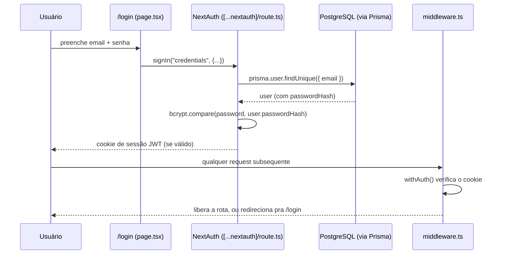

# 07 — Autenticação

> Fluxo completo, ponta a ponta, com o código real do projeto. NextAuth v4 com provider de credenciais e sessão JWT — não é um JWT feito na mão.

---

## 7.1 — Visão geral



---

## 7.2 — Configuração real (`src/lib/auth.ts`)

```ts
import { NextAuthOptions, getServerSession } from "next-auth";
import CredentialsProvider from "next-auth/providers/credentials";
import bcrypt from "bcryptjs";
import { prisma } from "./prisma";

export const authOptions: NextAuthOptions = {
  session: { strategy: "jwt" },
  pages: { signIn: "/login" },
  providers: [
    CredentialsProvider({
      name: "Credentials",
      credentials: {
        email: { label: "Email", type: "email" },
        password: { label: "Senha", type: "password" }
      },
      async authorize(credentials) {
        if (!credentials?.email || !credentials?.password) return null;
        const user = await prisma.user.findUnique({
          where: { email: credentials.email.toLowerCase() }
        });
        if (!user) return null;
        const ok = await bcrypt.compare(credentials.password, user.passwordHash);
        if (!ok) return null;
        return { id: user.id, email: user.email, name: user.name, role: user.role, avatarUrl: user.avatarUrl };
      }
    })
  ],
  callbacks: {
    async jwt({ token, user, trigger, session: newSession }) {
      if (user) {
        token.id        = (user as any).id;
        token.role      = (user as any).role;
        token.avatarUrl = (user as any).avatarUrl ?? null;
      }
      // Permite atualizar avatarUrl via useSession().update()
      if (trigger === "update" && newSession?.avatarUrl !== undefined) {
        token.avatarUrl = newSession.avatarUrl;
      }
      return token;
    },
    async session({ session, token }) {
      if (session.user) {
        (session.user as any).id        = token.id;
        (session.user as any).role      = token.role;
        (session.user as any).avatarUrl = token.avatarUrl ?? null;
      }
      return session;
    }
  }
};

export const auth = () => getServerSession(authOptions);
```

O handler de rota do NextAuth é o padrão mínimo, sem lógica extra:

```ts
// src/app/api/auth/[...nextauth]/route.ts
import NextAuth from "next-auth";
import { authOptions } from "@/lib/auth";

const handler = NextAuth(authOptions);
export { handler as GET, handler as POST };
```

**Como chamar em Server Components/rotas de API:** `const session = await auth();` — devolve `null` se não houver sessão, ou o objeto de sessão tipado. É a forma usada em toda rota protegida (ver `04-rotas-de-api.md`).

---

## 7.3 — Problema real: os `as any` espalhados em `auth.ts`

Repare, no código acima, seis ocorrências de `as any` — todas em `src/lib/auth.ts`. A causa raiz é que `src/types/next-auth.d.ts` (o arquivo que estende os tipos do NextAuth para o projeto) **não declara `avatarUrl`**, mesmo esse campo sendo lido e escrito em runtime o tempo todo:

```ts
// src/types/next-auth.d.ts — como está hoje
declare module "next-auth" {
  interface Session {
    user: {
      id: string;
      name: string;
      email: string;
      role: Role;
      // avatarUrl NÃO está aqui, apesar de ser usado em auth.ts, profile/route.ts, etc.
    };
  }
}
declare module "next-auth/jwt" {
  interface JWT {
    id: string;
    role: Role;
    // avatarUrl também ausente aqui
  }
}
```

Isso é um bug de tipagem real, não uma escolha deliberada — o `any` está mascarando um tipo incompleto, não contornando uma limitação genuína do NextAuth. **Se você for tocar em `auth.ts` ou em qualquer rota que leia `session.user.avatarUrl`**, a correção correta é adicionar `avatarUrl: string | null` nas duas interfaces acima (`Session.user` e `JWT`), o que elimina a necessidade dos `as any` correspondentes — não é recomendável adicionar mais `as any` por cima do problema existente.

---

## 7.4 — Middleware: proteção de rota

```ts
// src/middleware.ts — completo
import { withAuth } from "next-auth/middleware";

export default withAuth({
  pages: { signIn: "/login" }
});

export const config = {
  matcher: ["/((?!login|api/auth|uploads|_next/static|_next/image|favicon|.*\\..*).*)"]
};
```

`withAuth` do NextAuth v4 verifica automaticamente se existe uma sessão válida para qualquer rota que **não** esteja na lista de exclusão do `matcher`. Hoje, ficam de fora da exigência de sessão: `/login`, `/api/auth/*` (o próprio fluxo de login), `/uploads/*` (que tem sua própria checagem de sessão dentro do route handler — ver `04-rotas-de-api.md`), assets estáticos do Next e qualquer arquivo com extensão (`.*\\..*`).

**O middleware só verifica "existe sessão?"** — ele não verifica `role`. Controle de acesso por papel (ADMIN vs. USER) é feito **dentro** de cada página/rota que precisa disso, não centralizado no middleware.

---

## 7.5 — RBAC (controle por papel)

O projeto tem só dois papéis, definidos no enum Prisma `Role`: `USER` e `ADMIN`. Não há papéis intermediários nem permissões granulares — é uma checagem binária, repetida em cada ponto que precisa dela.

**Proteger uma rota de API por role** (padrão real, de `activities/[id]/review/route.ts`):
```ts
const session = await auth();
if (!session || session.user.role !== "ADMIN") {
  return NextResponse.json({ error: "forbidden" }, { status: 403 });
}
```

**Proteger uma página inteira por role** (Server Component, padrão real de `admin/page.tsx`):
```tsx
export default async function AdminPage() {
  const session = await auth();
  if (!session || session.user.role !== "ADMIN") redirect("/login");
  // ... busca dado e renderiza
}
```

**Esconder/mostrar UI por role** (Server Component que já tem a sessão, ex. em `page.tsx`):
```tsx
const isAdmin = session.user.role === "ADMIN";
// ... {isAdmin && <LinkParaAdmin />}
```

Não existe hoje um helper `requireAdmin()` compartilhado — essa checagem de duas linhas está copiada em cada rota/página administrativa. Ver `04-rotas-de-api.md` §4.4 para o contexto dessa duplicação e `12-guia-vibecoding.md` para a recomendação de extração, se e quando o time decidir endereçar isso.

---

## 7.6 — Credenciais de desenvolvimento

Reproduzido do `CLAUDE.md` para conveniência (fonte de verdade continua sendo lá): senha padrão do seed é `movimento2026`; admin é `garcez@garcez` (sem `.com` — confirmado contra `prisma/seed.ts`); demais usuários seguem os e-mails reais do time (`luizhenriquegarcez@gmail.com`, `douglas@luizgarcez.com.br`, `cleiton@luizgarcez.com.br`, `kellyadrsz1@gmail.com`, `milenna@luizgarcez.com.br`), não um padrão `{papel}@garcez.com`. **Nunca** alterar `NEXTAUTH_SECRET` em produção — isso invalida todas as sessões ativas instantaneamente.

---

## 7.7 — O que este fluxo não tem (hoje)

- Sem refresh token separado — sessão JWT expira conforme o padrão do NextAuth (`maxAge` não customizado no `authOptions`, então usa o default da lib).
- Sem OAuth/provider social (Google, Microsoft) — só credenciais (email/senha).
- Sem verificação de e-mail, sem "esqueci minha senha" self-service — reset de senha é uma operação manual feita por um admin (ver `admin/usuarios`).
- Sem rate limiting no `authorize()` — ver `11-seguranca.md` para o detalhamento desse risco.
